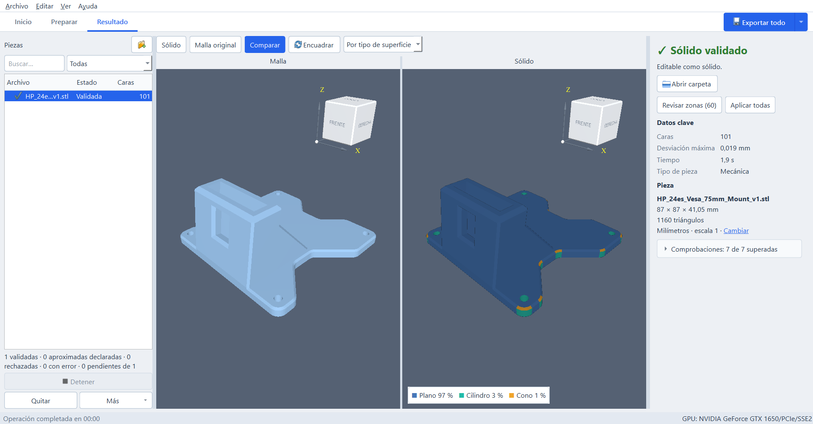
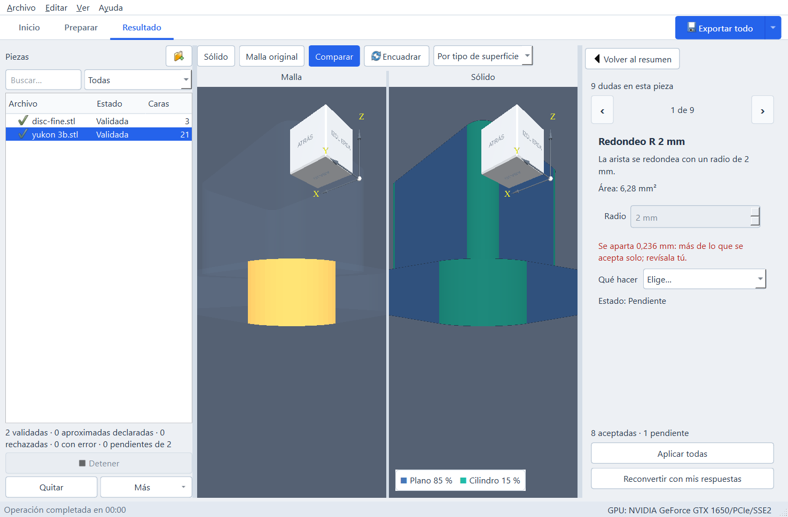

# MeshQSolid

**Español** | [English](README.en.md)

*(antes Mesh2Solid)*

Conversión de mallas 3D poligonales (STL, OBJ, 3MF) a sólidos CAD en formato STEP (B-Rep).

Está pensado para la impresión 3D: permite tomar una malla descargada de un repositorio o exportada de otro software, convertirla en sólido y modificarla en un editor de sólidos (cambiar una medida, añadir un taladro, adaptar un encaje) para volver a imprimirla. Funciona mejor con mallas que proceden de un diseño CAD exportado (las habituales con caras planas, cilindros y redondeos), ya que reconstruye esas superficies analíticas exactas. No es una herramienta de ingeniería inversa para escaneos 3D: las mallas de escáner (ruidosas, densas u orgánicas) no son su objetivo, y en esos casos el resultado será como mucho aproximado o facetado.

MeshQSolid reconstruye superficies analíticas (planos, cilindros, conos, revoluciones, solevados reglados y determinadas roscas normalizadas) a partir de mallas triangulares para su uso en editores de sólidos CAD.

**[Descargar MeshQSolid 0.2.0-beta para Windows x64](https://github.com/Qualith/MeshQSolid/releases/tag/v0.2.0-beta)** · paquete portable, sin instalación. Incluye la interfaz gráfica y `meshqsolid-cli.exe`, que convierte sin ventana para scripts y agentes de IA ([más abajo](#línea-de-comandos-y-agentes-sin-interfaz)).



---

> [!IMPORTANT]
> **Aviso de versión beta y revisión antes de fabricar:**
> - Esta versión es una **beta** y puede fallar.
> - Las piezas complejas (formas orgánicas, redondeos encadenados o superficies libres) saldrán como sólidos aproximados o facetados.
> - **Conviene revisar siempre la geometría y las dimensiones del resultado en tu editor de sólidos antes de fabricar**, como establece la licencia.
> - Si una pieza no sale bien, el reporte más útil es abrir una incidencia adjuntando el archivo de la malla.

---

## Qué piezas admite

| Tipo de pieza | Comportamiento | Resultado esperado |
|---|---|---|
| **Piezas mecánicas** | Soportes, carcasas, perfiles, ejes, bridas y taladros. Roscas normalizadas probadas en el banco (métricas ISO, paso unificado UNC y una trapecial) cuando la malla las define con claridad. | Sólido validado o aproximado. |
| **Piezas planas por capas (2,5D)** | Piezas planas hechas de capas extruidas, como fichas, insignias, llaveros, placas, posavasos o plantillas. Contornos de cada capa a escala 1:1 en SVG, para corte láser o vinilo. | Sólido validado o aproximado. |
| **Solevados (lofts)** | Transiciones entre secciones transversales regladas con tapas planas y taladros. | Sólido validado o aproximado según la malla. |
| **Archivos multicuerpo (3MF / STL)** | Varios cuerpos independientes en el mismo archivo. | Reconstrucción independiente por cuerpo en un único archivo STEP. |
| **Piezas orgánicas o escaneos libres** | Esculturas, figuras o modelos sin geometría analítica regular. | Sólido facetado (sólido de triángulos). |

---

## Niveles de reconstrucción

Al procesar una pieza, MeshQSolid indica el nivel alcanzado:

- **✓ Sólido validado (`solido_validado`)**: Todas las caras son superficies exactas y pasa nuestras comprobaciones a 0,05 mm.
- **≈ Sólido aproximado (`solido_aproximado`)**: La mayor parte con caras limpias y el resto facetado, con el porcentaje declarado.
- **▦ Sólido facetado (`solido_facetado`)**: Sólido de triángulos.

---

## Flujo de trabajo

El flujo general de la aplicación se organiza en cuatro pasos:

1. **Añadir piezas**: Carga archivos STL, OBJ o 3MF individuales, carpetas o lotes.
2. **Ajustes**: Selecciona el perfil y la tolerancia deseada para la reconstrucción (0,05 mm por defecto en el motor).
3. **Convertir**: Procesa las piezas pendientes en la cola.
4. **Ver el resultado**: Compara la malla y el sólido, revisa las zonas dudosas si las hay y exporta el STEP («Exportar todo» o «Exportar la seleccionada»).


---

## Revisión asistida

Cuando una pieza contiene detalles que admiten interpretación normalizada (como roscas métricas ISO o redondeos reconocibles sobre mallas bien definidas), el programa permite revisar cada zona detectada o aplicar en bloque las sugerencias que no superen la desviación geométrica de 0,05 mm. Las zonas se revisan de una en una: cada ficha muestra la propuesta, cuánto se aparta de la malla y qué hacer con ella.



---

## Piezas planas por capas (2,5D)

Para piezas planas hechas de capas extruidas, como fichas, insignias, llaveros, placas, posavasos o plantillas:
- Reconstrucción por capas a partir de caras opuestas.
- Exportación en SVG de los contornos de cada capa a escala 1:1, para corte láser o vinilo.
- Generación de cuerpos complementarios de relleno para impresión multicolor.

---

## Línea de comandos y agentes (sin interfaz)

`meshqsolid-cli.exe` hace la misma conversión que la interfaz, pero sin ventana. Sirve para procesar lotes desde un script o para que un agente de IA convierta piezas y lea el resultado: cada ejecución deja un resumen JSON breve, fácil de interpretar, y termina con un código de salida que indica el nivel alcanzado.

```powershell
meshqsolid-cli.exe pieza.stl --step pieza.step --summary resumen.json
```

- `--step <archivo.step>`: Exporta el sólido reconstruido en formato STEP.
- `--summary <resumen.json>`: Genera un resumen compacto en JSON (~2 KB, esquema `m2s-summary/1`) con el nivel obtenido, número de caras y desviación.
- `--tolerance <mm>`: Tolerancia superficial en milímetros (por defecto `0.05`).
- `--report <informe.json>`: Informe completo de la conversión, con las comprobaciones y los motivos.
- `--hints <pistas.json>`: Aplica decisiones ya revisadas sobre las zonas dudosas (roscas, redondeos…), el equivalente a la revisión asistida de la interfaz.
- Códigos de salida: `0` (sólido validado), `5` (sólido aproximado o facetado declarado), `3` (rechazado).
- Las carpetas de salida se crean solas, y la configuración puede aislarse por ejecución con la variable `MESH2SOLID_SETTINGS_FILE`.

---

## Requisitos e instalación

- **Sistema operativo**: Windows 10 o Windows 11 de 64 bits (x64).
- **Instalación**: Descarga el ZIP portable de la sección [Releases](https://github.com/Qualith/MeshQSolid/releases), descomprímelo en una carpeta y ejecuta `MeshQSolid.exe`. Conserva la carpeta `licenses/` y las DLLs junto al ejecutable. No requiere instalación adicional.

---

## Cómo informar de fallos

Los informes de los probadores son fundamentales para corregir problemas del motor geométrico:

1. Entra en la sección de [Issues](https://github.com/Qualith/MeshQSolid/issues).
2. Selecciona la plantilla correspondiente:
   - **Pieza no sale bien**: Si el modelo se rechaza, sale facetado o con errores. **Adjuntar el archivo de la malla (STL, OBJ o 3MF) es imprescindible para que podamos reproducir el fallo.** Incluye también el nivel obtenido y el archivo de resumen o registro.
   - **Fallo del programa**: Para bloqueos o cierres inesperados.
   - **Sugerencia**: Para propuestas sobre opciones o perfiles.

---

## Licencia y componentes de terceros

- **Licencia**: MeshQSolid es de uso gratuito tanto personal como comercial bajo los términos de [LICENSE.md](LICENSE.md). Los archivos generados (STEP, SVG) pertenecen al usuario.
- **Componentes de terceros**: El paquete incluye la carpeta `licenses/` con los avisos y licencias de las bibliotecas utilizadas (Open CASCADE Technology, Qt 6, entre otras).
